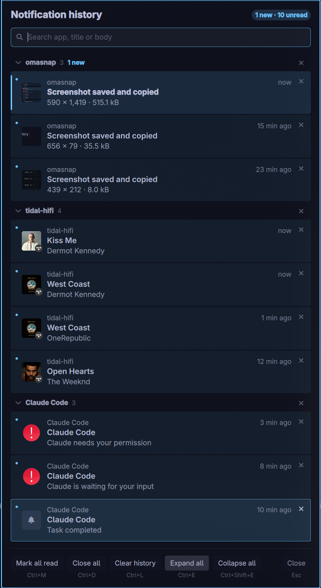

# Notification History for Omarchy

Keeps the notifications Omarchy already shows, so you can read them later. A bell in
the bar tells you how many arrived since you last looked, and the panel lists them
grouped by app, with their images, newest first.



This is a fork of [GaboEI/omarchy-notification-center](https://github.com/GaboEI/omarchy-notification-center)
that adds search, app groups, keyboard control, undo, a "new" highlight and
notification images.

## What it does

- a **bell in the bar** with a count of notifications that arrived since you last
  opened the panel;
- a **panel under the bell** with the recent history, **grouped by app**, newest first;
- **new rows stand out** with an accent bar and bold title; older unread rows keep a dot;
- the **image a notification carried** (a screenshot, an album cover) shown on its row;
- **search** by app, title or text;
- **everything from the keyboard**, with every removal undoable for 10 seconds.

Everything stays on your computer; nothing is sent over the network.

## Install

```sh
omarchy plugin add https://github.com/HritwikSinghal/omarchy-notification-center --enable
```

The bell appears at the right of the bar. To install by hand, copy this folder to
`~/.config/omarchy/plugins/gabodev.notification-center/`, then run:

```sh
omarchy-shell shell rescanPlugins
omarchy plugin enable gabodev.notification-center --section right
```

Tested on an Omarchy 4.0 development build. Image capture needs `python3` and
`busctl`, both part of a standard Omarchy install.

### Open it with a key

The plugin adds no key binding of its own. To open it with one, add a line like this to
your Hyprland bindings (`~/.config/hypr/bindings.lua`):

```lua
o.bind("SUPER + ALT + N", "Notification history",
  [[omarchy-shell shell toggle gabodev.notification-center '{"anchorX":100000}']])
```

`anchorX` pins the panel to the top-right corner; leave the payload out to centre it.

## Use

Click the bell to open the panel; right click it to turn Do Not Disturb on or off.
You can drag the bell anywhere on the bar and the panel opens underneath it.

The search line always has the keyboard, so typing filters the list at once.

| Key | Does |
|---|---|
| Up / Down | Select the previous / next row |
| Tab / Shift+Tab | Jump to the next / previous app group |
| Enter | Open the selected notification's app |
| Left / Right | Fold / unfold the selected row's group (with an empty search) |
| Delete | Remove the selected row |
| Shift+Delete | Remove the selected row's whole group |
| Ctrl+Z | Undo the last removal (10 s; press again to go further back) |
| Esc | Clear the selection, then the search, then close the panel |

Clicking a row opens or focuses the app it came from. Click a group's header to fold it.

## The buttons

Each button's shortcut is written under it.

| Button | Key | What it does |
|---|---|---|
| **Mark all read** | Ctrl+M | Nothing counts as new or unread any more; closes the panel |
| **Close all** | Ctrl+D | Removes every row and dismisses any notification still on screen |
| **Clear history** | Ctrl+L | Removes every row from the panel |
| **Expand all** | Ctrl+E | Opens every group, showing its newest 5 rows (or all its unread ones, if more); press again to restore |
| **Collapse all** | Ctrl+Shift+E | Folds every group to its newest row |
| **Close** | Esc | Closes the panel without changing anything |

After **Close all** or **Clear history** the panel stays open and says how to undo it.

## New and unread

- **New**: arrived since you last closed the panel. These rows get an accent bar, a
  stronger fill and a bold title; group headers and the header show how many. The
  bell counts only these.
- **Unread**: arrived since you last pressed **Mark all read**. These keep a small dot.

Closing the panel turns new rows into ordinary unread ones.

## Images

Omarchy shows a notification's image on its popup but does not keep it. The plugin
runs a small helper (`capture/notify-capture.py`) that listens to the notifications on
your session bus, without replacing or talking to the notification service, and saves
each image it sees. Album covers sent as raw pixels are shrunk to a thumbnail first.

Only notifications that arrive while the plugin is running get an image; images are
kept for 48 hours, up to 300.

## Do Not Disturb

Right click the bell and it turns into a **red bell with a line through it**. Omarchy
then stops showing notification cards; they go straight into the history. Right click
again to turn it off. A few system notices (Omarchy's own prompts, critical alerts,
verification codes) still come through by design. Do Not Disturb is Omarchy's own
setting, so the bell stays in sync if you change it anywhere else.

## How it works

Omarchy's notification service writes each notification it shows to
`~/.local/state/omarchy/notifications/history.json` (the most recent 100). The plugin
reads that file and draws it as a list; it never edits it, so **Clear history** hides
rows from this panel only.

The plugin's own files:

| File | Holds |
|---|---|
| `~/.config/omarchy/gabodev.notification-center/config.json` | When you last read, last closed the panel and last cleared, and which rows you removed |
| `~/.cache/gabodev.notification-center/` | Captured images and their index |

## Good to know

- **Clicking a row does its best, and tells you when it cannot.** A notification with
  an action (a screenshot to open) opens exactly. Chat apps' messages are gone by the
  time they reach the history, so the plugin focuses or opens the app instead, and says
  so when it can do neither.
- **The count is per notification**, not per chat.
- **The panel follows your desktop language.** Spanish and English are included.

## Debugging

```sh
omarchy-shell notification-center state      # the panel's live state, as JSON
omarchy-shell notification-center debug on   # log to the shell log ([nc:...] lines)
omarchy-shell notification-center debug off
```

## Uninstall

```sh
omarchy plugin disable gabodev.notification-center
omarchy plugin remove gabodev.notification-center --yes
```

To discard the saved settings and images as well:

```sh
rm -rf ~/.config/omarchy/gabodev.notification-center ~/.cache/gabodev.notification-center
```

## License

GPL-3.0-or-later. See [LICENSE](LICENSE).

Forked from [GaboEI/omarchy-notification-center](https://github.com/GaboEI/omarchy-notification-center),
which is MIT-licensed; its notice is kept in [LICENSE.MIT](LICENSE.MIT).
